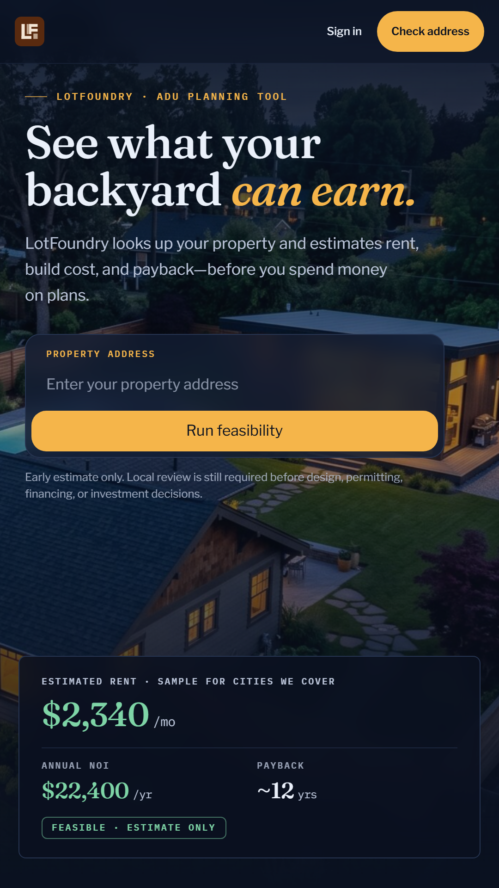
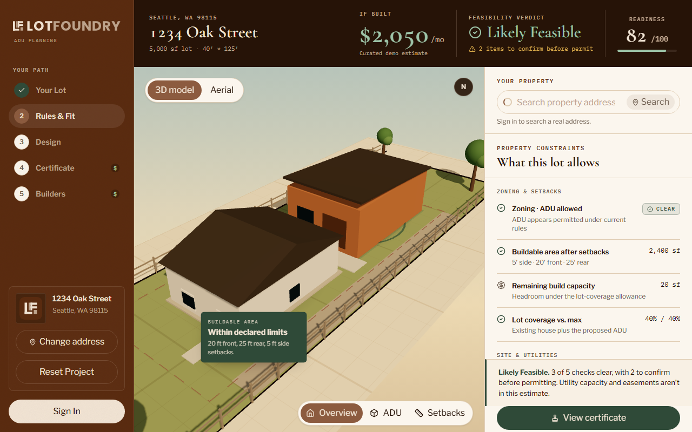

# LotFoundry

**AI-assisted ADU feasibility studio for homeowners and residential builders.**

Enter an address—or explore built-in demo parcels—to estimate what may fit, what it may cost, what it may earn, and which questions require a local professional.

[Try the live app](https://lotfoundry.net) ·
[Read the documentation](docs/README.md) ·
[Architecture guide](AGENTS.md) ·
[Design system](docs/design/README.md)

## Preview

<p>
  
  
  
</p>

Home and feasibility studio on phone, and the studio on tablet.

## What it does

- Searches real residential parcels through Regrid, public parcel GIS services,
  the US Census geocoder, and Google Maps integrations.
- Visualizes the lot, existing home, setbacks, and a movable ADU concept in 3D.
- Estimates build cost, rent, annual NOI, payback, and basic zoning fit.
- Uses authenticated OpenAI Responses API workflows for a parcel-and-permit
  brief and style-matched ADU concepts.
- Produces a shareable, printable Certificate of Feasibility.
- Saves scenarios with Firebase Auth and Firestore, while guest scenarios stay
  local to the browser.
- Supports homeowner-to-builder handoff and verified web/native purchase
  channels.
- Resolves real lots without a paid parcel API wherever the public GIS registry
  has coverage, then falls back to the Seattle, Portland, and Austin demo parcels.

LotFoundry is an early planning instrument, not a permit decision, appraisal,
construction document, or substitute for professional advice.

## AI architecture & intelligent workflows

LotFoundry integrates OpenAI models to augment deterministic spatial calculations with structured qualitative analysis:

- **Responses API orchestration:** AI workflows run through the OpenAI Responses API with structured JSON schemas and bounded tool-calling loops, defaulting to `gpt-5.6-sol` (configurable via environment variables).
- **Jurisdiction & permit brief:** A bounded tool loop joins localized municipal zoning bylaws, lot dimensions, and setback requirements into a concise, plain-English summary of risks and requirements.
- **Style-matched ADU concepts:** Multimodal vision understanding analyzes architectural details (roof pitches, cladding materials, window styles, exterior palettes) from user-uploaded photos to guide image generation of matching ADU designs. Photo uploads require explicit opt-in consent.
- **Deterministic source of truth:** Calculations for setbacks, square footage, site coverage, construction costs, rental yields, and financial returns remain strictly deterministic. AI models do not guess arithmetic or spatial measurements.

## Studio access

On the web, guests open the demo Studio directly and signed-in owners start from
an address. In the Android and iOS apps only, the Studio opens with a welcome,
sign-in, and a quick guide; sign-in is required for a real property, and demo
cities stay open to guests. See
[`docs/design/2026-09-12-app-studio-onboarding.md`](docs/design/2026-09-12-app-studio-onboarding.md).

## Run locally

Prerequisite: Node.js 22.12 or newer, matching CI and the Firebase Functions runtime.

```bash
npm ci
npm run dev
```

Open `http://localhost:3000`. The built-in demo parcels work without API keys.

For live parcel data, authenticated saves, AI generation, and payments:

```bash
cp .env.example .env.local
```

Fill only the services you intend to test. Never commit `.env.local`,
`functions/.env`, signing keys, or store-service credentials.

Analytics stays off locally unless you opt in. `NEXT_PUBLIC_GA_MEASUREMENT_ID`
is empty in `.env.example`, and with no measurement ID the Google Analytics tag
never loads and the cookie banner never renders. Set it to a `G-XXXXXXXXXX` ID
only if you are deliberately testing the consent flow, and use a separate GA4
property so local traffic never lands in production reporting.

## Verify

```bash
npm run repo:public-check
npm run check
npm run test:e2e
```

The public-repository check catches common secret formats, generated release
binaries, accidental local-agent state, and large tracked files. The core check
runs lint, unit tests, TypeScript, and the production build.

## Android release status

`native/android/` contains the generated Trusted Web Activity project and its
source-of-truth configuration for package `com.lotfoundry.app`, including
Digital Asset Links for both the upload key and Play App Signing certificate,
Play Billing bridge dependencies, and manifest screenshots.

```bash
npm run android:validate
npm run android:validate:release
```

The normal validator checks committed configuration. The strict release
validator must be run from the prepared release workspace after the signed AAB
exists. A clean checkout is expected to fail the final AAB-presence check because
release binaries and signing material are intentionally excluded from Git.

## Architecture & technology stack

| Area | Technology | Purpose |
|---|---|---|
| **Web app** | Next.js 16 (App Router), React 19, TypeScript 5, Tailwind CSS 4 | Core web platform, server rendering, and API routes |
| **Spatial 3D UI** | Three.js, React Three Fiber, Google Maps JS API | Interactive lot visualization, setbacks, and ADU placement |
| **Data & auth** | Firebase Hosting, Cloud Functions (Node 22), Auth, Firestore | Serverless hosting, microservices, auth, and database |
| **AI** | OpenAI Responses API with GPT-5.6 Sol defaults | Structured permit briefs and style-matched concept generation |
| **Commerce** | Stripe API, Google Play Billing & Apple App Store verification | Builder lead unlocks and cross-platform purchase verification |
| **Mobile** | PWA, Android TWA (`com.lotfoundry.app`), iOS Capacitor shell | Mobile app packaging and store distribution |
| **Quality** | Vitest, Playwright, ESLint, TypeScript, GitHub Actions | Unit, integration, E2E, and CI/CD release pipelines |

## Documentation directory

Operating documentation is maintained in the [`docs/`](docs/README.md) directory:

- [**docs/README.md**](docs/README.md) — Documentation index and reading order.
- [**AGENTS.md**](AGENTS.md) — Engineering guidelines, architecture map, and operational rules.
- [**docs/design/**](docs/design/README.md) — Design system authority (A LOT MORE typography, colors, layout rules).
- [**docs/deployment.md**](docs/deployment.md) — Firebase Hosting, Cloud Functions deployment, and rollback runbooks.
- [**docs/feasibility-engine-interface.md**](docs/feasibility-engine-interface.md) — Mathematical contracts and financial calculations.
- [**docs/ai-integration-plan.md**](docs/ai-integration-plan.md) — OpenAI Responses API schemas, prompts, and safety guards.
- [**docs/plans/monetization-marketplace-ai.md**](docs/plans/monetization-marketplace-ai.md) — Builder marketplace and checkout architecture.
- [**docs/release-checklist.md**](docs/release-checklist.md) — Pre-release inspection checklist.
- [**docs/repo-governance.md**](docs/repo-governance.md) — Triage matrix, debugging methodologies, and maintenance schedules.
- [**docs/debugging-guide.md**](docs/debugging-guide.md) — Systematic defect diagnosis and bisect procedures.

## Security and privacy

- Server secrets stay server-side and must never use a `NEXT_PUBLIC_*` name.
- AI photo upload requires explicit consent.
- Google Analytics is opt-in: no tag loads and no analytics cookie is set until
  the visitor accepts the cookie banner, and declining also clears any GA cookie
  left from an earlier grant. Advertising and personalization signals are
  disabled, and no address, email, or feasibility result is sent to Google.
- Account export and deletion are available from Settings.
- Security reports should follow [SECURITY.md](SECURITY.md), not a public issue.

## License

Copyright © 2026 Andrew Torralba. All rights reserved. This repository is source-available
under the [LotFoundry Evaluation License](LICENSE); it is not an open-source license
and does not grant redistribution or commercial use.
