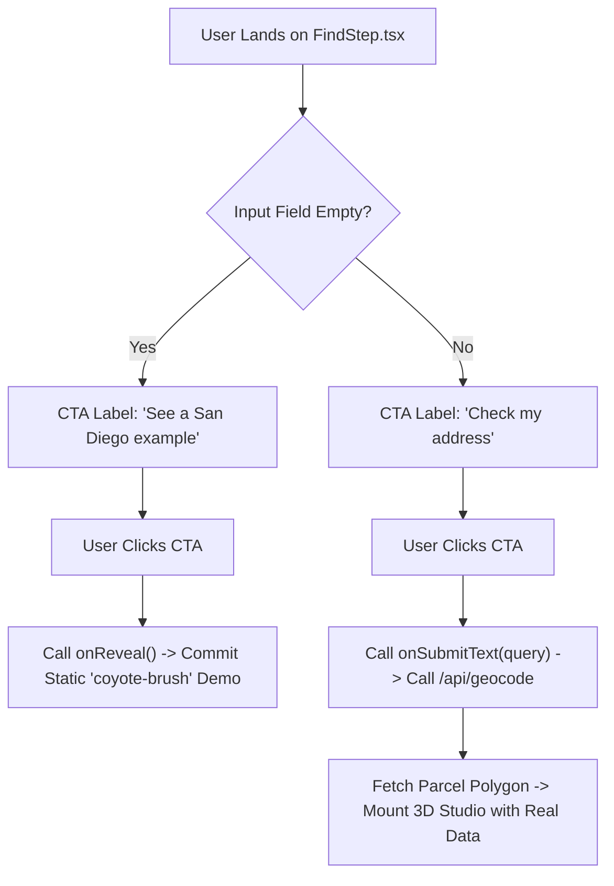
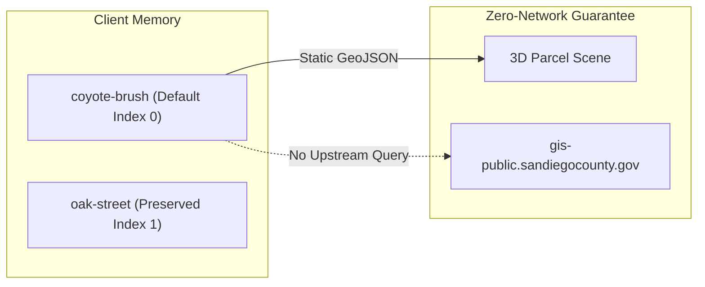
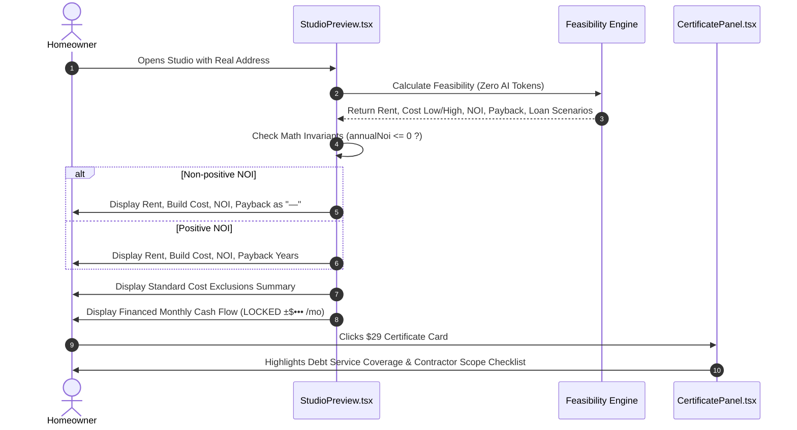

# LotFoundry Funnel & Certificate Activation

* **Author:** Andrew Torralba
* **Status:** Proposed
* **Date:** 2026-11-01

---

## Overview

LotFoundry provides an algorithmic 3D ADU feasibility studio and a $29 Feasibility Certificate for residential property owners. Operational data through October 2026 reveals severe friction across the top and middle of the conversion funnel: 26 organic search visitors, 3 search clicks, a 65% to 90% mobile demo skip rate, and zero customer purchases of the $29 Certificate. 

This design coordinates two structural fixes to restore funnel continuity:
1. Eliminating mobile address entry blockers that divert up to 90% of mobile users into an unwanted default demo.
2. Resolving the gating contradiction where marketing channels promise free estimated build cost, rent, and payback, while the Studio blurs those figures behind a $29 paywall.

The design aligns the product with its marketing commitments by unblurring the basic build cost range, annual net income, and simple payback period on the user's evaluated parcel. To establish sustainable commercial value, the $29 Certificate is repositioned to resolve two high-stakes planning milestones: leveraged monthly financing feasibility ("Will rent cover my loan payment?") and contractor bid leveling ("Is my builder's scope complete?").

## The Problem

Homeowners exploring an ADU face immediate uncertainty around three questions: can an ADU fit their lot, what will it cost to build, and will the rental income justify the investment. LotFoundry's acquisition funnel fails to address these questions due to two distinct failures:

1. **Mobile Activation Drop-off**: Mobile devices account for the majority of visitor sessions. When a visitor lands in `FindStep.tsx`, `AddressSearch.tsx` encapsulates input state privately. Because Google Places Autocomplete dropdowns are disabled for unauthenticated guests to control API costs, mobile visitors type their street address and tap the bottom CTA button. However, the button unconditionally invokes `onReveal()`, which discards the typed text and commits the preselected demo parcel (formerly Seattle, WA). As a result, users evaluate an irrelevant out-of-state lot or abandon the session immediately.
2. **The Gating Contradiction**: Organic search snippets, the marketing homepage hero, and the `/adu-cost-calculator` route explicitly state that estimated build cost, rental income, and payback period are free with no account required. However, upon evaluating their own lot in `StudioPreview.tsx`, visitors find build cost, annual net income, and payback period locked behind a $29 paywall. This broken expectation erodes user trust before value is established. Furthermore, locking simple payback while displaying estimated rent and cost is ineffective, as payback is trivial division once the underlying figures are known.
3. **Misaligned Paywall Triggers**: The $29 Certificate was originally positioned around exploratory insights ("See what could drive the numbers..."). Casual visitors do not pay $29 for generic estimates. They pay when triggered by real-world commitments: preparing for a lender interview, reviewing plans with a designer, or comparing conflicting contractor bids.

## Goals

* **Direct Address Submission**: Enable mobile guests to submit typed street addresses directly from `FindStep.tsx` via the bottom CTA button, routing cleanly to parcel lookup without committing the demo preset.
* **Transparent Demo Exploration**: Provide a clear distinction between demo evaluation and live property evaluation by labeling empty-state CTA as "See a San Diego example" and rendering a persistent demo badge in the Studio.
* **Geographic Relevance**: Default demo evaluations to San Diego (`coyote-brush`, RS-1-7 zoning, HUD FY2027 fair market rents) to match the 82% California user base.
* **Marketing and Studio Gating Alignment**: Unblur estimated build cost range, annual net income, and simple payback period on user-evaluated parcels in `StudioPreview.tsx`, including clear disclaimers of standard cost exclusions.
* **High-Stakes Certificate Positioning**: Reposition the $29 Certificate in `CertificatePanel.tsx` to answer leveraged monthly debt service coverage and contractor scope completeness.
* **Contractor Alignment**: Rename "Builder Bid Checklist" to "Scope Checklist" across UI panels and reports, presenting itemized scope allowances without adversarial pricing verdicts.
* **Zero-Regressions Release**: Maintain zero AI token costs for unauthenticated guests, prevent non-finite math displays (`NaN`, `Infinity yrs`), and preserve in-memory parcel state across authentication redirects.

## Non-Goals

* **Paid Marketing and Ad Campaigns**: No budget allocation or technical tooling for paid search, social ads, or sponsored placements.
* **Studio-Level City/ZIP Discovery**: No intermediate municipal or ZIP-level exploratory mode inside the 3D Studio; the Studio requires concrete parcel boundaries. Exploratory discovery remains handled upstream by city guide landing pages.
* **Builder CRM and Referral Dashboards**: No development of contractor partner portals, affiliate lead tracking, or builder subscription tiers.
* **PDF Engine Overhaul**: No architectural replacement of the existing PDF generation pipeline or Firestore security rule contracts.
* **Soft Email Capture Gates**: No mandatory email collection barrier prior to revealing high-level build cost ranges and simple payback.

## Open Questions

* None open. Core trade-offs (retaining blurred cost vs. unblurring, builder referral positioning vs. consumer pricing, and mobile input mechanics) were resolved during predecessor ideation.

## Critical User Journeys (CUJs)

### CUJ 1: Mobile Guest Evaluates Real Address
* **Given**: An unauthenticated visitor on a mobile device navigating to `/studio`.
* **When**: The visitor types `"5124 35th St, San Diego, CA"` into the search input in `FindStep.tsx` and taps `"Check my address"`.
* **Then**: The input state is lifted to `FindStep.tsx`, triggering `onSubmitText` rather than `onReveal`. The application hits `/api/geocode`, loads the corresponding parcel boundaries, and transitions into the 3D Studio showing live feasibility metrics for that parcel, without committing the demo preset.

### CUJ 2: Guest Explores San Diego Demo
* **Given**: An unauthenticated visitor who enters `/studio` without an address in mind.
* **When**: The visitor leaves the search field empty and taps `"See a San Diego example"`.
* **Then**: The system selects the default `coyote-brush` preset from local static memory without initiating any external network call to municipal GIS. The 3D Studio renders the parcel with a persistent `"Demo Mode: San Diego, CA"` badge and an immediate `"Evaluate My Lot"` shortcut button.

### CUJ 3: Homeowner Reviews Free Feasibility & Upgrades to Certificate
* **Given**: A property owner evaluating their real parcel in `StudioPreview.tsx`.
* **When**: The owner inspects the feasibility overview.
* **Then**: Estimated monthly rent, build cost range, annual net income, and simple payback period are displayed unblurred, accompanied by a clear notice of standard site and soft cost exclusions. Financed monthly cash flow remains locked behind the $29 Certificate. When the owner clicks the Certificate card to verify loan payment coverage and contractor scope completeness, in-memory parcel data is stashed to survive authentication, and the checkout session initializes.

---

## Technical Plan (Architecture)

### 1. Mobile Entry State Machine (`AddressSearch` & `FindStep`)

The mobile onboarding entry in `components/studio/mobile/journey/FindStep.tsx` wraps `components/studio/AddressSearch.tsx`. Currently, `AddressSearch` manages its text state internally via `useState("")`, preventing `FindStep` from observing user typing.

#### Mechanism:
1. **Interface Extension (`AddressSearchProps`)**:
   Add an optional `onQueryChange?: (query: string) => void` callback to `AddressSearchProps`. In `AddressSearch.tsx`, propagate text changes from `handleInputChange` to `onQueryChange(value)`.
2. **Dynamic CTA in `FindStep.tsx`**:
   `FindStep.tsx` tracks `hasQuery: boolean` and `queryText: string`. 
   - When `hasQuery === false`: CTA button renders `"See a San Diego example"` and fires `onReveal()`.
   - When `hasQuery === true`: CTA button renders `"Check my address"` and fires `onSubmitText(queryText)`.
3. **Reassurance Microcopy**:
   Directly beneath the input form, render a privacy reassurance string pinned to ground styling:
   `"We only use your address to fetch lot geometry and zoning rules. We don't save your address or contact you unless you create an account."`
4. **Demo State Indication**:
   When entering the Studio via `onReveal()`, activate a persistent header badge in `FeasibilityStudio.tsx` (`"Demo Mode: San Diego, CA"`) accompanied by a button linking directly back to address search (`"Evaluate My Lot"`).

---

### 2. Geographic Preset Realignment (`lib/feasibility.ts`)

The user base is 82% California-based, yet demo defaults currently point to Seattle, WA (`oak-street`). The default demo lot across both the marketing landing hero (`lib/landing-demo.ts`, `LotMoreLanding.tsx`) and the Studio must point to San Diego.

#### Mechanism:
1. **Array Ordering in `lib/feasibility.ts`**:
   Reorder `parcelPresets` so that `coyote-brush` (RS-1-7 zoning, 6,200 sq ft, HUD FY2027 fair market rents) is index `0`, making it the default across all consumers of `parcelPresets[0]`.
2. **Embedded Geometry Invariant**:
   The San Diego municipal GIS endpoint (`gis-public.sandiegocounty.gov`) operates without an address-situs index and has no SLA. The full geometry and parcel attributes for `coyote-brush` must remain hardcoded in `parcelPresets` so loading the demo involves zero network requests.
3. **Gaussian Splat Conditional Display**:
   Because `coyote-brush` uses standard procedural mesh geometry rather than a Gaussian Splat scan (which is specific to `oak-street-curated.spz`), the 3DGS splat toggle must evaluate `activeParcel.id === "oak-street"` and conditionally hide on `coyote-brush`.

---

### 3. Studio Gating Alignment & Math Safety (`StudioPreview.tsx`)

`StudioPreview.tsx` currently blurs build cost, annual net income, payback period, and financed monthly cash flow. We align the preview with marketing promises by unblurring the direct baseline metrics while reserving advanced financial modeling for the Certificate.

#### Presentation Specification (4-Card Metric Grid):
1. **Estimated Monthly Rent**: Unlocked (`rentRangeLabel(result)`).
2. **Estimated Build Cost**: Unlocked (`formatCompactCurrency(costLow) – formatCompactCurrency(costHigh)`).
3. **Annual Net Income**: Unlocked (`formatCompactCurrency(annualNoi)`).
4. **Estimated Payback Period**: Unlocked, governed by mathematical safety:
   - If `annualNoi <= 0` or `!isFinite(paybackYears)`: render `"N/A"` or `"—"` instead of rendering `Infinity yrs` or `NaN`.
5. **Financed Monthly Cash Flow**: Strictly Locked (`±$••• /mo` with Lock icon and Certificate upgrade CTA).
6. **Cost Exclusions Notice**: Directly below the build cost card, render a clear disclaimer:
   `"Estimated construction range. Excludes site grading, utility trenching, municipal impact fees, and architectural soft costs."`

---

### 4. Certificate Repositioning & Scope Leveling (`CertificatePanel.tsx`)

The Certificate offer must transition from generic exploration copy to answering two high-stakes homeowner decisions:

1. **Leveraged Debt Service Coverage ("Will rent cover my loan payment?")**:
   Unlocks pro forma monthly cash flow models across construction loans and home equity lines of credit (HELOC), calculating net monthly income after principal, interest, taxes, and insurance.
2. **Contractor Scope Leveling ("Is my builder's scope complete?")**:
   Unlocks the itemized scope allowance checklist, allowing homeowners to cross-reference builder bids against standard municipal requirements, site work, and finish allowances.

#### Neutral Framing Invariant:
Rename all occurrences of `"Builder Bid Checklist"` to `"Scope Checklist"` across `lib/certificate-bid-checklist.ts`, `ReportPreview.tsx`, and `lib/report.ts`. The checklist itemizes required scopes and standard allowances without issuing subjective verdicts (such as "overpriced", "below market", or "fair") to prevent adversarial contractor friction.

#### Checkout Disclosure:
Display an unambiguous consumer disclaimer at the point of purchase:
`"Preliminary algorithmic planning estimate; does not constitute a municipal building permit, zoning warranty, or architectural certification."`

---

### 5. Architectural & System Boundaries

| Subsystem | Active Components | Boundary Rules |
| :--- | :--- | :--- |
| **Studio Entry** | `FindStep.tsx`, `AddressSearch.tsx` | Must not depend on Google Places dropdowns for mobile guest submissions. |
| **Feasibility Calculation** | `lib/feasibility.ts`, `lib/feasibility-verdict.ts` | 100% deterministic client-side execution; zero AI token consumption on free preview. |
| **Gating Presentation** | `StudioPreview.tsx` | Unblurs cost, rent, NOI, payback; locks debt-financed cash flow; guards non-finite math. |
| **Monetization & Auth** | `CertificatePanel.tsx`, `lib/auth-context.tsx` | In-memory parcel state stashed before auth redirect via `stashInitialParcel`. |
| **Reporting & Export** | `lib/certificate-bid-checklist.ts`, `lib/report.ts` | Uses "Scope Checklist" naming; neutral allowance itemization without price verdicts. |

---

## Alternatives Considered

### Alternative 1: Retain Current Gating (Keep Build Cost Blurred) and Remove Free Promises from Marketing Copy
* **Pros**: Maintains maximum gating tension around the $29 Certificate; keeps proprietary localized cost estimates completely behind the paywall.
* **Cons**: In October 2026, 33 real lookups produced 23 offer views, 9 checkout starts, and zero sales. Telemetry proves that locking cost estimates failed to generate revenue while imposing a 100% bounce rate at checkout. Furthermore, payback is simple division once rent is known, and hiding costs directly contradicts free calculators and builder baseline estimates widely available online.
* **Reason for Rejection**: The gate has not converted any paying users. Forcing an unknown user to pay $29 before validating baseline feasibility creates an insurmountable barrier for an early-stage product with limited brand recognition. Promising numbers in acquisition channels and locking them upon arrival destroys trust.

### Alternative 2: Make Feasibility 100% Free and Monetize Exclusively via Builder Lead Unlocks ($30–$49/lead)
* **Pros**: Removes all consumer friction; maximizes top-of-funnel engagement; shifts monetization to commercial budgets better suited for lead acquisition expenses.
* **Cons**: Contractor network is currently unmonetized with zero active accounts. Monthly homeowner inquiry volume is in the single digits (October recorded 5 homeowner emails and 6 builder match views). Total potential monthly revenue under this model is currently under $300.
* **Reason for Rejection**: Eliminates consumer software revenue prematurely before testing an aligned consumer offer. Builders are significantly more valuable as a zero-cost referral channel (referring unvetted leads for free qualification before spending unbilled site visit time) than as an immediate revenue source.

### Alternative 3: Soft Email Gate (Require Account or Email Capture to Unblur Build Cost Range)
* **Pros**: Builds a registered user email list for automated nurture sequences and re-engagement campaigns.
* **Cons**: Introduces high friction immediately after address entry, directly violating the product promise ("First address free, no account needed"). Drops address lookup completion rates on mobile devices without guaranteeing valid email inputs or qualified intent.
* **Reason for Rejection**: Increases drop-off before demonstrating core 3D interactive value. User trust is lowest at initial entry; demanding contact details before delivering utility reduces overall funnel velocity.

### Alternative 4: Disable the Mobile Button When Address Field is Empty
* **Pros**: Prevents users from accidentally submitting an empty search box or unintentionally viewing the demo lot.
* **Cons**: Disabling the primary mobile CTA renders the button inert without explaining why, frustrating users who expect to explore sample feasibility before typing their personal address.
* **Reason for Rejection**: Changing the CTA label dynamically ("See a San Diego example" when empty vs. "Check my address" when typed) provides transparent signposting without disabling interface controls or blocking exploratory user journeys.

---

## Non-Functional Requirements

### Security & Privacy
* **Zero Persistence of Guest Address Lookups**: Guest address strings entered in `FindStep.tsx` and geocoded via `/api/geocode` are processed ephemerally in memory to retrieve parcel polygons and zoning attributes. No database writes or analytics capture of exact unauthenticated addresses occur unless the user explicitly creates an account or purchases a Certificate.
* **Payment Processing**: Stripe Checkout handles all payment card processing via hosted sessions (`app/api/stripe/checkout/route.ts`). No cardholder data touches LotFoundry infrastructure.
* **Authentication State Stashing**: Guests initiating checkout have their active parcel and feasibility scenario stashed in `sessionStorage` via `stashInitialParcel` so authentication handoffs via OAuth or email link do not discard user work.

### Performance & Latency
* **Zero-Token Free Tier Invariant**: The unblurred free Studio preview in `StudioPreview.tsx` relies exclusively on deterministic client-side calculation engines (`lib/feasibility.ts`). It makes zero upstream calls to `/api/ai/*`, ensuring zero marginal LLM token costs for exploratory visitors.
* **Zero-Network Static Demo**: San Diego default demo geometry (`coyote-brush`) is fully statically embedded in client code, guaranteeing instantaneous demo loading with zero dependency on the un-SLA'd municipal GIS endpoint (`gis-public.sandiegocounty.gov`).
* **Geocoding Throttling**: Address geocoding requests through `/api/geocode` incorporate debouncing and error handling to respect upstream rate limits (1 QPS on Nominatim fallbacks).

### Rollout & Rollback Strategy
* **Coupled Atomic Release**: All changes (mobile entry state machine, San Diego default preset, unblurred `StudioPreview`, and repositioned `CertificatePanel`) must be deployed together in a single atomic release. Unblurring costs without shipping the new debt service and scope checklist copy would eliminate conversion incentives on existing traffic.
* **Rollback Verification**: In the event of an unexpected regression, git revert to the prior master commit safely restores the blurred preview state and Seattle demo without data migration or database rollback dependencies.

---

### Additional Resources
* `docs/AGENTS.md`: Full architecture map, current status, and known constraints.
* `lib/feasibility.ts`: Feasibility calculation formulas and default parcel presets.
* `lib/certificate-bid-checklist.ts`: Itemized standard ADU construction allowances and scope checklist items.
* `concepts_brief.md`: Initial ideation brief and synthesized Goldfish review findings.

### Future Improvements
* **City/ZIP Staged Entry**: Introduce an intermediate municipal or postal code entry step prior to parcel resolution once mobile conversion baselines stabilize.
* **Builder Verification Network**: Allow vetted San Diego general contractors to review regional cost allowances and receive qualified homeowner scope checklists directly via secure deep links.

---

## Detailed Implementation Plan

### Target Files to Create/Modify

#### 1. `YardUp/components/studio/AddressSearch.tsx` (Modify)
* **Type / Scope**: React Component / Address Input & Places Autocomplete Boundary
* **Proposed Changes**:
  - Extend `AddressSearchProps` interface with optional `onQueryChange?: (query: string) => void`.
  - In `handleInputChange`, invoke `props.onQueryChange?.(e.target.value)` synchronously alongside internal `setQuery(e.target.value)`.
  - In `handleClear` or reset handlers, invoke `props.onQueryChange?.("")`.
  - Retain the existing invariant that disables Google Places Autocomplete predictions for anonymous guest visitors to control external API quota consumption.
* **Rationale**: Enables parent container (`FindStep.tsx`) to react to user keystrokes and inspect whether an address has been typed without breaking guest API throttling rules.

#### 2. `YardUp/components/studio/mobile/journey/FindStep.tsx` (Modify)
* **Type / Scope**: React Component / Mobile Studio Onboarding Entry
* **Proposed Changes**:
  - Maintain local state `queryText: string` and `hasQuery: boolean` updated via `AddressSearch`'s `onQueryChange`.
  - Conditionally compute the bottom CTA button label:
    - `hasQuery ? "Check my address" : "See a San Diego example"`
  - Conditionally route the bottom CTA `onClick` handler:
    - If `hasQuery`: invoke `onSubmitText(queryText.trim())`.
    - If `!hasQuery`: invoke `onReveal()`.
  - Add static privacy microcopy directly below the address search input:
    `"We only use your address to fetch lot geometry and zoning rules. We don't save your address or contact you unless you create an account."` styled with `--stone-dark` / subtle ground typography.
* **Rationale**: Eliminates the 90% mobile drop-off vulnerability where tapping the primary CTA committed the mock preset and ignored typed street addresses.

#### 3. `YardUp/lib/feasibility.ts` (Modify)
* **Type / Scope**: Core Feasibility Engine / Parcel Presets Configuration
* **Proposed Changes**:
  - Reorder `parcelPresets` array so that `coyote-brush` (San Diego, RS-1-7, 6,200 sq ft lot, HUD FY2027 rents) is positioned at index `0`.
  - Preserve `oak-street` at index `1`.
  - Ensure all static GeoJSON coordinates, boundary polygons, setbacks, and existing building footprints for `coyote-brush` remain hardcoded in memory, guaranteeing zero network requests to `gis-public.sandiegocounty.gov`.
* **Rationale**: Aligns default demonstration data with the 82% California user demographic while maintaining zero-network demo reliability.

#### 4. `YardUp/lib/landing-demo.ts` (Modify)
* **Type / Scope**: Landing Page Helper
* **Proposed Changes**:
  - Update default preset identifier references from `"oak-street"` to `"coyote-brush"`.
  - Verify exported helper functions return San Diego baseline metrics.
* **Rationale**: Keeps marketing landing calculations aligned with the Studio's default parcel state.

#### 5. `YardUp/components/landing/lot-more/LotMoreLanding.tsx` (Modify)
* **Type / Scope**: Marketing Landing Page Component
* **Proposed Changes**:
  - Update demo address label and initial interactive preview state to reflect Coyote Brush Court, San Diego, CA.
  - Ensure CTA navigation to `/studio` defaults to the San Diego preset.
* **Rationale**: Eliminates cross-page visual discrepancies between the marketing hero and Studio entry.

#### 6. `YardUp/components/ParcelScene.tsx` (Modify)
* **Type / Scope**: Three.js / R3F 3D Scene Renderer
* **Proposed Changes**:
  - Guard Gaussian Splat viewer instantiation: mount splat rendering only if `activeParcel.id === "oak-street"`.
  - For `coyote-brush` and arbitrary user addresses, render procedural terrain, boundary lines, and structural ADU mesh boxes.
  - Hide splat visual controls and toggles when active parcel is not `oak-street`.
* **Rationale**: `coyote-brush` lacks a Gaussian Splat model; preventing splat loader initialization prevents 404 errors and broken 3D rendering states.

#### 7. `YardUp/components/FeasibilityStudio.tsx` (Modify)
* **Type / Scope**: Primary Studio Orchestrator
* **Proposed Changes**:
  - When the Studio is viewing a preset committed via `onReveal()` (demo exploration), render a persistent status badge in the studio header or toolbar:
    `"Demo Mode: San Diego, CA"`.
  - Include an adjacent action button `"Evaluate My Lot"` that resets studio parcel state and returns the user to the address search input.
* **Rationale**: Clearly informs exploratory users that they are viewing sample property data and provides an immediate recovery path to evaluate their real lot.

#### 8. `YardUp/components/studio/StudioPreview.tsx` (Modify)
* **Type / Scope**: React Component / Feasibility Metrics Preview
* **Proposed Changes**:
  - Unblur Estimated Build Cost card (`formatCompactCurrency(costLow) – formatCompactCurrency(costHigh)`).
  - Unblur Estimated Annual Net Income card (`formatCompactCurrency(annualNoi)`).
  - Unblur Estimated Simple Payback Period card (`formatYears(paybackYears)`).
  - Implement mathematical safety guards: if `annualNoi <= 0` or `!isFinite(paybackYears)`, render `"—"` or `"N/A"` rather than `Infinity yrs` or `NaN`.
  - Keep Financed Monthly Cash Flow strictly locked (`±$••• /mo` with Lock icon and Certificate upgrade CTA).
  - Render static cost exclusions disclaimer directly below the build cost card:
    `"Estimated construction range. Excludes site grading, utility trenching, municipal impact fees, and architectural soft costs."`
* **Rationale**: Fulfills marketing promises for free cost and payback while preventing math errors and reserving advanced debt financing models for the Certificate.

#### 9. `YardUp/components/studio/CertificatePanel.tsx` (Modify)
* **Type / Scope**: React Component / Certificate Offer & Paywall Card
* **Proposed Changes**:
  - Replace generic exploratory copy with two decision-support value propositions:
    1. Leveraged Monthly Debt Service: *"Will rent cover your loan payment?"* (Unlocks pro forma construction loan and HELOC cash flow models).
    2. Contractor Scope Leveling: *"Is your builder's scope complete?"* (Unlocks itemized scope checklist and dimensioned site plan PDF).
  - Add consumer checkout disclaimer text:
    `"Preliminary algorithmic planning estimate; does not constitute a municipal building permit, zoning warranty, or architectural certification."`
  - Ensure parcel and scenario state are preserved via `stashInitialParcel` upon clicking checkout.
* **Rationale**: Reorients the Certificate from generic exploratory estimates to actionable planning decisions required when meeting with lenders and general contractors.

#### 10. `YardUp/lib/certificate-bid-checklist.ts` (Modify)
* **Type / Scope**: TypeScript Data & Constants / Bid Leveling Checklist
* **Proposed Changes**:
  - Rename exported symbols, types, and labels from "Builder Bid Checklist" to "Scope Checklist" (`SCOPE_CHECKLIST`, `ScopeChecklistItem`).
  - Maintain neutral scope itemization and standard cost allowances without rendering subjective price judgments ("overpriced", "below market", "fair").
* **Rationale**: Positions the checklist as an objective scope coordination tool, avoiding adversarial friction with general contractors who review client reports.

#### 11. `YardUp/lib/report.ts` (Modify)
* **Type / Scope**: TypeScript PDF & Print Report Generator
* **Proposed Changes**:
  - Update section headers, table titles, and narrative descriptors from "Builder Bid Checklist" to "Scope Checklist".
* **Rationale**: Synchronizes report terminology with UI panels and updated data structures.

#### 12. `YardUp/components/studio/ReportPreview.tsx` (Modify)
* **Type / Scope**: React Component / In-Studio Certificate Preview
* **Proposed Changes**:
  - Update tab labels, modal headings, and preview callouts to display "Scope Checklist".
* **Rationale**: Maintains terminology consistency across desktop report previews.

#### 13. `YardUp/components/studio/mobile/journey/FindStep.test.tsx` (Modify)
* **Type / Scope**: Vitest Unit Test
* **Proposed Changes**:
  - Add unit test: verifies empty input displays CTA button `"See a San Diego example"` and fires `onReveal()`.
  - Add unit test: verifies typing text changes CTA button to `"Check my address"` and fires `onSubmitText(typedQuery)`.
  - Add unit test: asserts presence of privacy reassurance string in rendered output.
* **Rationale**: Guarantees mobile entry behavior does not regress to the Seattle demo commit bug.

#### 14. `YardUp/components/studio/StudioPreview.test.tsx` (Modify)
* **Type / Scope**: Vitest Unit Test
* **Proposed Changes**:
  - Add unit test: verifies build cost, annual net income, and payback period render unblurred with valid values.
  - Add unit test: verifies non-finite payback guard renders `"—"` when `annualNoi <= 0`.
  - Add unit test: verifies financed monthly cash flow remains locked with lock indicator.
* **Rationale**: Ensures gating alignment and prevents regressions in financial rendering logic.

#### 15. `YardUp/lib/feasibility.test.ts` (Modify)
* **Type / Scope**: Vitest Unit Test
* **Proposed Changes**:
  - Update assertions to expect `parcelPresets[0].id === "coyote-brush"`.
  - Verify static polygon geometry and zoning attributes are present on `parcelPresets[0]`.
* **Rationale**: Verifies that San Diego remains the default preset across all consumers.

#### 16. `YardUp/lib/certificate-bid-checklist.test.ts` (Modify / Create)
* **Type / Scope**: Vitest Unit Test
* **Proposed Changes**:
  - Assert that exported items follow the "Scope Checklist" naming convention.
  - Assert that checklist items do not expose price judgment properties.
* **Rationale**: Enforces contractor-neutral framing invariants via automated tests.

---

### Verification Plan

#### 1. Automated Unit & Integration Testing
* **Command**: `npm.cmd run test` (executed from `YardUp/`)
* **Coverage Scope**:
  - `FindStep.test.tsx`: Validates dynamic mobile button states, callback dispatch, and privacy copy.
  - `StudioPreview.test.tsx`: Validates unblurred cost/payback, division-by-zero guards, and locked cash flow.
  - `feasibility.test.ts`: Validates `coyote-brush` preset indexing and static coordinates.
  - `certificate-bid-checklist.test.ts`: Validates neutral checklist structure and export symbols.
* **Exit Criteria**: All unit tests pass with 0 failures.

#### 2. Static Analysis & Type Checking
* **Commands**:
  - `npx.cmd tsc --noEmit` (executed from `YardUp/`)
  - `npm.cmd run lint` (executed from `YardUp/`)
* **Exit Criteria**: TypeScript compiles with 0 errors; ESLint exits with 0 warnings.

#### 3. Production Compilation Build
* **Command**: `npm.cmd run build` (executed from `YardUp/`)
* **Exit Criteria**: Next.js App Router production build completes successfully with static pages generated.

#### 4. End-to-End Browser Verification
* **Commands**: `npx.cmd playwright test e2e/studio.spec.ts` (or focused mobile spec)
* **Manual Verification Checklist**:
  1. Open `/studio` on simulated mobile viewport (iPhone 14 / Pixel 7):
     - Empty field shows `"See a San Diego example"`. Clicking it opens `coyote-brush` with `"Demo Mode: San Diego, CA"` badge.
     - Typing an address changes button to `"Check my address"`. Clicking it calls geocode and loads the typed parcel.
  2. Inspect `StudioPreview.tsx` on a real parcel:
     - Rent, build cost range, annual net income, and simple payback are visible unblurred.
     - Cost exclusions disclaimer is visible directly below build cost.
     - Financed monthly cash flow is blurred and locked.
  3. Inspect `CertificatePanel.tsx`:
     - Debt service coverage and contractor scope checklist copy are displayed.
     - Consumer disclaimer is visible at checkout initiation.

---

*Drafted with EGM*
