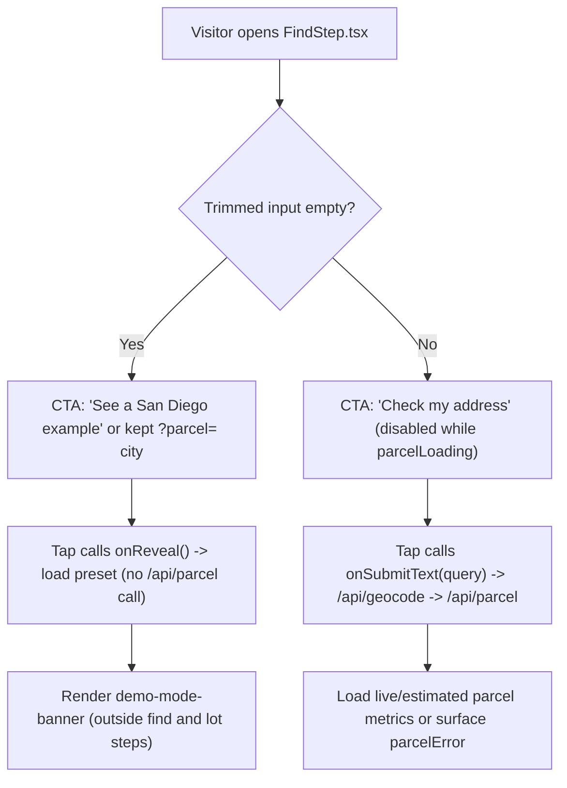
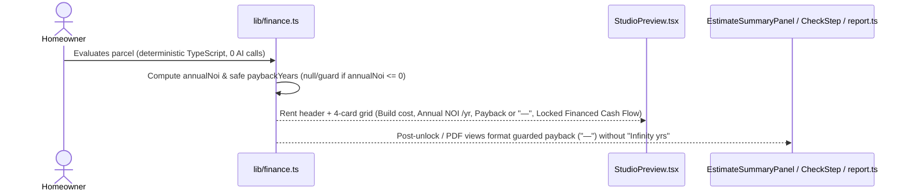

# LotFoundry Funnel & Certificate Activation

*   **Author:** Andrew Torralba
*   **Status:** Proposed
*   **Date:** 2026-11-18

> **Amendment (2026-11-18, Andrew):** The unblurred preview is reversed. Before purchase, `StudioPreview.tsx` shows only the rent range and locks `Build cost`, `Annual net income`, `Payback period` and `Financed cash flow`. The pre-Studio `LotAnswerCard.tsx` answer is a teaser: the address, a status chip and "Open in 3D", with no lot size, zoning, fit detail, rent, cost or payback. Reason: showing the figures before purchase gave away the Certificate's value. Where this document describes unblurred cards, the amendment takes precedence.

--------------------------------------------------------------------------------

## Overview

LotFoundry provides a free 3D Accessory Dwelling Unit (ADU) feasibility studio and a Feasibility Certificate (configured at $29) for residential property owners. According to `concepts_brief.md` (October 2026 baseline), search traffic was low (26 organic search visitors and 3 search clicks), 65% to 90% of visitors viewed sample lots rather than evaluating their own property, and zero paid Certificates had been purchased.

The original initiative addressed two issues:

1. Mobile visitors who typed an address and tapped the bottom button were routed into the Seattle sample preset instead of their own lot.
2. Marketing pages promised free build cost, rent, and payback estimates with no account required, while the Studio blurred build cost, annual Net Operating Income (NOI), and payback behind the Certificate paywall.

Most of those UI and offer changes are now implemented in `YardUp/`. This document records the updated architecture and specifies the remaining codebase delta: guarding non-positive NOI payback formatting at the shared `lib/finance.ts` boundary, consolidating address privacy microcopy in `AddressSearch.tsx`, disabling rapid mobile submit taps while `parcelLoading` is true, aligning `StudioPreview.tsx` soft-cost copy with `lib/finance.ts`, cleaning up residual legacy checklist strings, and adding missing unit tests (while keeping `oak-street` as `parcelPresets[0]` / Studio default so 3DGS scan coverage and `/studio?parcel=coyote-brush` non-default deep links remain intact).

## The Problem

Homeowners evaluating an ADU need three baseline figures before committing money: whether a unit fits their lot, estimated construction cost, and whether rent supports the expense. The pre-change flow created three gaps (and several residual inconsistencies remain):

1. **Mobile Address Entry Dropped Typed Input (Baseline Fixed, Tap Guard Remaining)**: Anonymous visitors do not receive Google Places autocomplete dropdowns because autocomplete predictions are disabled for unauthenticated guests to limit API billing. Previously, tapping the bottom button in `FindStep.tsx` ignored typed text and loaded the Seattle sample preset. That routing bug is now fixed, though `FindStep.tsx` still allows repeat taps while a parcel lookup is in flight (`parcelLoading`).
2. **Broken Free-Estimate Promise & Sibling Payback Gaps**: Marketing pages promised free build cost, rent, and payback estimates without an account. Previously, `StudioPreview.tsx` showed only rent while blurring build cost, annual NOI, and payback. `StudioPreview.tsx` now unblurs those three cards and guards `annualNoi <= 0` with `"—"`; however, `lib/finance.ts` still divides by `annualNoi` unguarded, leaving `EstimateSummaryPanel.tsx`, `CheckStep.tsx`, and `lib/report.ts` able to render `Infinity yrs`.
3. **Weak Certificate Offer Hypothesis & Residual Copy Drift**: The Certificate previously used exploratory messaging (*"See what could drive the numbers..."*). Our design hypothesis (unvalidated at October's 26-visitor sample size) is that homeowners pay when preparing for a lender conversation or checking whether a contractor's bid omits work. While `CertificatePanel.tsx` and `Scope Checklist` headings are updated, residual `"bid-leveling"` strings remain in `ReportPreview.tsx`, `lib/report.ts`, and `LotMoreLanding.tsx`, and `FeasibilityStudio.tsx:1650` / `ConstraintsPanel.tsx:114` omit the address privacy note.

## Goals

*   **Preserve San Diego Funnel Routing & `oak-street` Baseline Contract**: Keep `lib/landing-demo.ts`, `LotMoreLanding.tsx`, `app/page.tsx`, and `FindStep.tsx`'s `"See a San Diego example"` CTA routed to `coyote-brush` (San Diego, using Department of Housing and Urban Development [HUD] FY2027 fair market rents, matching the 82% California user share reported in `concepts_brief.md`), while preserving `parcelPresets[0]` (`"oak-street"`) as the Studio's structural default so 3DGS photoreal scan (`e2e/studio-photoreal-scan.spec.ts`) and `/studio?parcel=coyote-brush` non-default landing links (`isNonDefaultScenario`) stay intact.
*   **Prevent Repeat Mobile Lookup Taps**: Disable the `FindStep.tsx` submit action while `parcelLoading` is true.
*   **Unify Address Privacy Copy**: Move the literal privacy notice onto `AddressSearch.tsx` as an optional prop enabled across `FindStep.tsx`, `FeasibilityStudio.tsx` (`LotStep` and the `feasibility` side rail), and `ConstraintsPanel.tsx`.
*   **Guard Non-Positive Payback Everywhere**: Prevent `Infinity` or negative payback output at the shared `lib/finance.ts` / formatter boundary so `EstimateSummaryPanel.tsx`, `CheckStep.tsx`, and `lib/report.ts` match `StudioPreview.tsx` (`"—"`).
*   **Finish Neutral `"Scope Checklist"` & Disclosure Alignment**: Replace remaining `"bid-leveling"` UI copy in `ReportPreview.tsx` and `LotMoreLanding.tsx`, document the CSV export policy, and align `StudioPreview.tsx` exclusions text with `lib/finance.ts` (`constructionBudgetNote`) so it accurately states that a modeled soft-cost allowance is included.
*   **Track Funnel Impact via Existing Telemetry**: Measure real-address lookup share vs. sample-lot views, checkout starts, and completed Certificate purchases using existing events in `lib/analytics/events.ts`, evaluated at 100 real-address evaluations or 30 calendar days post-release.

## Non-Goals

*   **Paid Advertising**: No ad spend, campaign setup, or paid acquisition tooling.
*   **City or ZIP Browsing Inside the Studio**: The 3D Studio remains parcel-based; broader city browsing stays on static city guide pages.
*   **New Contractor Portal or Referral Work**: Do not add or modify contractor portals (`BuildersPanel`, `/builder`), partner accounts, or affiliate referral tracking in this release.
*   **PDF Engine, Security Rule, or API Auth Overhauls**: No replacement of the PDF generator, changes to Firestore security rules, or server-side `requireApiAuth` refactoring on `isGuestRequest()` / `/api/geocode` / `/api/parcel` (tracked separately for a dedicated security PR).
*   **Feasibility Math Formula Changes**: Keep `calculateFinance` (`softCostMultiplier = 1.18`) unchanged; align disclosure copy rather than altering cost math.
*   **Email Gates or Runtime A/B Frameworks**: No email capture barrier before free cost ranges, and no runtime A/B feature-flagging inside `StudioPreview.tsx`.

## Open Questions

*   None open. (Post-launch conversion review threshold, soft-cost disclosure alignment, and `isGuestRequest()` auth hardening scope are resolved under Goals, Non-Goals, Risks & Mitigations, and Phase 2.)

## Critical User Journeys (CUJs)

### CUJ 1: Mobile Visitor Evaluates Their Own Address

*   **Given**: An unauthenticated visitor opens `/studio` on a mobile device.
*   **When**: The visitor types a street address into `AddressSearch` inside `FindStep.tsx` and taps `"Check my address"`.
*   **Then**: The button disables while `parcelLoading` is true, `/api/geocode` resolves the coordinates, `/api/parcel` loads the property, and the 3D Studio opens for that address without loading the sample preset. If lookup fails, `FindStep.tsx` surfaces `parcelError`.

### CUJ 2: Visitor Explores the San Diego Sample Preset

*   **Given**: An unauthenticated visitor opens `/studio` without typing an address and without a `?parcel=` query override.
*   **When**: The visitor leaves the search input empty and taps `"See a San Diego example"`.
*   **Then**: The Studio loads `coyote-brush` in preset mode (`parcelMode === "preset"`) without calling `/api/parcel` or municipal GIS servers, displays `[data-testid="demo-mode-banner"]` (`"Demo Mode: San Diego, CA"`) with `"Evaluate My Lot"` in the step body (and hides the 3D Gaussian Splat [3DGS] Scan toggle because `coyote-brush` is not registered in `lib/splat-registry.ts`). If the visitor arrives via `?parcel=oak-street`, `FindStep.tsx` keeps `oak-street` via `presetChosen` and labels the banner `"Demo Mode: Seattle, WA"`.

### CUJ 3: Homeowner Reviews Free Estimates and Upgrades to the Certificate

*   **Given**: A homeowner views an evaluated parcel in `StudioPreview.tsx` (free preview) on desktop or mobile `CheckStep.tsx`.
*   **When**: They review the baseline numbers and select the Certificate card (`CertificatePanel.tsx`, distinct from `ReportPreview.tsx` which previews the paid Certificate report).
*   **Then**: Estimated monthly rent appears in the header above a 4-card 2×2 grid showing unblurred `Build cost`, `Annual net income` (` /yr`), `Payback period` (` yrs`, or `"—"` when `annualNoi <= 0`), and locked `Financed cash flow` (`±$••• /mo`). Selecting the Certificate invokes `stashInitialParcel` (`lib/parcel-handoff.ts`) and `rememberCertificatePurchaseIntent` (`lib/certificate-purchase-intent.ts`) in `sessionStorage` alongside `FeasibilityStudio.tsx` URL `replaceState` sync, and displays the preliminary-estimate disclaimer before checkout.

--------------------------------------------------------------------------------

## Technical Plan (Architecture)

Most of the funnel alignment architecture is already live in `YardUp/`. This section documents the active system boundaries and the targeted remaining adjustments.

### 1. Entry State Machine, Desktop Parity, and Privacy Copy (`AddressSearch.tsx`, `FindStep.tsx`, `FeasibilityStudio.tsx`)

On mobile, `FindStep.tsx` wraps `AddressSearch.tsx` and receives typed input via `onQueryChange`. Desktop search renders `<AddressSearch>` directly inside `FeasibilityStudio.tsx` (`LotStep` and the `feasibility` side rail) and `ConstraintsPanel.tsx`, where submitting an address calls `onSubmitText` immediately on form submission rather than routing through `FindStep.tsx`'s `onReveal()` CTA.

*   **Baseline Already Live**: `AddressSearch.tsx` exposes `onQueryChange` and suppresses Places dropdowns for unauthenticated guests (`signedIn = Boolean(user)`). `FindStep.tsx` tracks `queryText`, `presetChosen`, and `userPickedPreset` to switch CTA labels and callbacks. `FeasibilityStudio.tsx` renders `[data-testid="demo-mode-banner"]` dynamically as `Demo Mode: <City>` whenever `!isRealAddressActive && parcelMode === "preset"` outside `find` and `lot` steps.
*   **Remaining Delta**:
    *   Guard `FindStep.tsx` submit button with `disabled={parcelLoading}` to prevent rapid double-taps.
    *   Centralize the literal privacy notice (*"We only use your address to fetch lot geometry and zoning rules. We don't save your address or contact you unless you create an account."*) on `AddressSearch.tsx` via an optional prop (`showPrivacyNote?: boolean`) enabled on `FindStep.tsx`, `FeasibilityStudio.tsx` (`LotStep` and `feasibility` side rail), and `ConstraintsPanel.tsx`.

### 2. San Diego Funnel Routing and `oak-street` Baseline Contract (`lib/feasibility.ts`, `lib/scenario-url.ts`, `lib/splat-registry.ts`)

*   **Baseline Contract**: `lib/landing-demo.ts`, `components/landing/lot-more/LotMoreLanding.tsx`, `app/page.tsx`, and `FindStep.tsx` (`"See a San Diego example"`) already route visitors to `"coyote-brush"` (`san-diego`). Preset mode (`parcelMode === "preset"`) bypasses `/api/parcel` and municipal GIS (`gis-public.sandiegocounty.gov`) because `ParcelPreset` stores scalar lot dimensions (`lotArea`, `lotWidth`, `lotLength`, `existingHouseSqft`, `maxLotCoveragePercent`, `setbacks`, `expectedRent`, `marketData`) rendered procedurally in 3D. 3DGS splat visibility (`oak-street-curated.spz`) is already gated by `lib/splat-registry.ts` (`CURATED_SPLAT_SCENES` / `getSplatSceneForParcel`) and `FeasibilityStudio.tsx` (`hasScan={Boolean(splatScene)}`), requiring no changes in `ParcelScene.tsx`.
*   **No Preset-Default Change**: `parcelPresets[0]` (`"oak-street"`) remains the baseline for `FeasibilityStudio.tsx`, `createScenarioState`, and `defaultScenarioState`: changing `defaultScenarioState.parcelId` to `"coyote-brush"` breaks `studio-photoreal-scan.spec.ts` (which expects `oak-street`'s registered Scan view on `/studio`) and flips `isNonDefaultScenario` so `/studio?parcel=coyote-brush` landing links stop skipping mobile `Find`.

### 3. Shared Payback Formatting and Preview Boundary (`lib/finance.ts`, `StudioPreview.tsx`, `EstimateSummaryPanel.tsx`, `CheckStep.tsx`, `lib/report.ts`)

*   **Baseline Already Live**: `StudioPreview.tsx` renders `Estimated monthly rent` above the 4-card grid (`Build cost`, `Annual net income`, `Payback period`, and locked `Financed cash flow` with `±$••• /mo` and CSS `blur-xs`), applies the `"—"` guard locally, and makes zero calls to `/api/ai/*`.
*   **Remaining Delta**: Guard non-positive NOI (`annualNoi <= 0` or `!Number.isFinite(paybackYears)`) at the shared `lib/finance.ts` / formatter boundary (`formatPaybackYears`) so `EstimateSummaryPanel.tsx`, `CheckStep.tsx`, and `lib/report.ts` cannot print `Infinity yrs` or negative years. Update `StudioPreview.tsx` exclusions text (line 76) to match `constructionBudgetNote` (`lib/finance.ts:28`) rather than claiming architectural soft costs are excluded when `softCostMultiplier` (`1.18`) is applied. Note `StudioPreview.tsx:71` retains placeholder text `±$••• /mo` with `blur-xs` (update or align its doc comment if removing `blur-xs`).

### 4. Certificate Repositioning, Neutral Checklist, and Auth Handoff (`CertificatePanel.tsx`, `ReportPreview.tsx`, `lib/report.ts`, `LotMoreLanding.tsx`)

*   **Baseline Already Live**: `CertificatePanel.tsx` displays the loan-coverage and scope-completeness offer copy (Home Equity Line of Credit [HELOC] and construction loan pro formas), displays the preliminary-estimate checkout disclaimer, and invokes `stashInitialParcel` (`lib/parcel-handoff.ts`) and `rememberCertificatePurchaseIntent` (`lib/certificate-purchase-intent.ts`) using `sessionStorage` alongside `FeasibilityStudio.tsx` URL `replaceState` sync. `lib/certificate-bid-checklist.ts` exports `ScopeChecklistItem` and `SCOPE_CHECKLIST`.
*   **Remaining Delta**: Replace residual `"bid-leveling"` strings in `ReportPreview.tsx` (`"3-builder bid-leveling checklist"`, `"Builder RFQ sheet"`, `BID_LEVELING_CHECKLIST` / `BID_LEVELING_BUILDERS` imports) and `LotMoreLanding.tsx` (`"bid-leveling checklist for three builders"`), keep `lib/certificate-bid-checklist.ts` filename unchanged, and keep `"Bid Item ..."` CSV export headers in `lib/report.ts` stable (or explicitly versioned) for downstream CSV consumers.

### Component Boundaries and Upstream Quotas

| Subsystem | Components / Modules | Boundary Rule |
| :--- | :--- | :--- |
| **Address Entry** | `AddressSearch.tsx`, `FindStep.tsx`, `FeasibilityStudio.tsx`, `ConstraintsPanel.tsx`, `app/api/geocode/route.ts` | Mobile submission works without Places dropdowns; `FindStep.tsx` disables submit while `parcelLoading` is true; `/api/geocode` enforces per-IP `checkRateLimit` (10 req/min for guests), emits `Cache-Control: private, max-age=3600`, and falls back to `geocodeWithCensus(query)`. |
| **Sample Presets & 3DGS** | `lib/feasibility.ts`, `lib/scenario-url.ts`, `lib/splat-registry.ts`, `lib/landing-demo.ts` | `coyote-brush` loads in `preset` mode with no `/api/parcel` call; `lib/splat-registry.ts` gates 3DGS scan availability (`oak-street` only); `parcelPresets[0]` (`oak-street`) remains Studio baseline while landing/`FindStep` route demo clicks to `coyote-brush`. |
| **Feasibility Math & Preview** | `lib/finance.ts`, `StudioPreview.tsx`, `EstimateSummaryPanel.tsx`, `CheckStep.tsx`, `lib/report.ts` | Deterministic client math with zero `/api/ai/*` calls; shared non-positive NOI payback guard returns `"—"` across all views. |
| **Certificate & Telemetry** | `CertificatePanel.tsx`, `lib/certificate-bid-checklist.ts`, `ReportPreview.tsx`, `lib/analytics/events.ts` | Best-effort `sessionStorage` + URL state handoff; neutral `"Scope Checklist"` wording; funnel events tracked via existing `lib/analytics/events.ts`. |

--------------------------------------------------------------------------------

## Alternatives Considered

### Alternative 1: Keep Build Cost Blurred and Remove Free Promises from Marketing Copy

*   **Pros**: Keeps all build cost and payback figures behind the Certificate paywall.
*   **Cons**: With low visitor volume and limited brand recognition, requiring payment before showing any build cost stops visitors from validating basic feasibility and directly contradicts search snippets and landing-page promises.
*   **Reason for Rejection**: Misaligned landing-page claims and Studio paywall behavior increased bounce rates before visitors could assess lot feasibility.

### Alternative 2: Make Feasibility Free and Monetize Only via Builder Lead Credits ($30–$49/lead)

*   **Pros**: Removes consumer payment friction and shifts revenue to commercial contractor budgets.
*   **Cons**: Active builder supply is zero accounts and monthly homeowner inquiries are in single digits (`concepts_brief.md`), which cannot support lead-credit monetization.
*   **Reason for Rejection**: Eliminates direct consumer revenue before testing whether an aligned Certificate offer converts.

### Alternative 3: Soft Email Gate (Require Email Capture to Unblur Build Cost Range)

*   **Pros**: Captures visitor email addresses before showing cost numbers.
*   **Cons**: Adds a form barrier immediately after mobile address entry, conflicts with *"First address free, no account needed"*, and encourages low-quality email entries.
*   **Reason for Rejection**: Increases mobile drop-off before demonstrating lot feasibility.

### Alternative 4: Disable the Mobile CTA Button When the Address Field Is Empty

*   **Pros**: Prevents sample-lot loads when a visitor taps the button without typing an address.
*   **Cons**: Leaves the primary button inactive with no clear exploration path for visitors who want to preview the Studio before entering their address.
*   **Reason for Rejection**: Dynamic CTA labeling (`"See a San Diego example"` vs. `"Check my address"`) prevents accidental sample-lot loads while keeping exploration one tap away.

### Alternative 5: Partial Unblurring (Show Build Cost Range Free While Keeping Payback Locked)

*   **Pros**: Preserves an additional locked metric card in `StudioPreview.tsx`.
*   **Cons**: Still contradicts landing pages and search snippets that explicitly promise free payback estimates, and invites trivial division once rent and cost are visible.
*   **Reason for Rejection**: Leaving simple payback blurred fails to align the Studio with acquisition promises.

--------------------------------------------------------------------------------

## Non-Functional Requirements

*   **Security & Privacy**: Guest street addresses geocoded through `/api/geocode` stay in browser memory, `window.history.replaceState` URL parameters (`FeasibilityStudio.tsx`), `lib/analytics/events.ts` bucketed events, and best-effort `sessionStorage` (`stashInitialParcel`, `rememberCertificatePurchaseIntent`) when initiating checkout. Stripe Checkout handles all payment card data.
*   **Performance & Quota Controls**: Free preview calculations run deterministically in client TypeScript with zero `/api/ai/*` calls. `coyote-brush` preset mode triggers no `/api/parcel` or municipal GIS calls. Guest `/api/geocode` requests are bounded server-side by `checkRateLimit` (10 req/min per IP), `Cache-Control: private, max-age=3600`, and `geocodeWithCensus` fallback.
*   **Rollout & Rollback**: Remaining delta fixes ship together with updated tests and rollback cleanly via `git revert` with no database migrations or Firestore rule changes.

--------------------------------------------------------------------------------

## Risks & Mitigations

*   **Lookup Failures on Unvalidated Mobile Strings**: Typing free-text addresses without Places autocomplete can yield `/api/geocode` 404s or `/api/parcel` fallback responses (`presetFallbackResponse`). Mitigation: `FindStep.tsx` surfaces `parcelError` inline for retry, disables repeat taps while `parcelLoading` is true, and falls back to `geocodeWithCensus` when Nominatim misses.
*   **`parcelPresets[0]` Baseline Coupling**: Changing `parcelPresets[0]` or `defaultScenarioState.parcelId` alters `getParcelById("unknown")`, breaks 3DGS scan visibility expectations on `/studio` (`studio-photoreal-scan.spec.ts`), and flips `isNonDefaultScenario` for `/studio?parcel=coyote-brush` landing links. Mitigation: Keep `oak-street` as `parcelPresets[0]` and `defaultScenarioState.parcelId` while routing `/` landing and `FindStep.tsx`'s empty CTA to `coyote-brush`.
*   **Best-Effort `sessionStorage` Handoff Loss**: OAuth redirects across isolated mobile webviews can drop `sessionStorage`. Mitigation: `FeasibilityStudio.tsx` mirrors scenario parameters into the URL via `replaceState`, preserving lot/config state across reloads without adding heavy cross-tab persistence infrastructure.
*   **Unvalidated Conversion Assumption**: At 26 search visitors and 0 prior sales, post-release Certificate conversion remains unverified. Mitigation: Evaluate `lib/analytics/events.ts` (`trackFeasibilityResultViewed` with `parcel_mode !== "preset"`, `trackCertificateCheckoutStarted`, `trackCertificatePurchase`) after **100 real-address evaluations or 30 calendar days post-release** (whichever comes first); trigger a Certificate offer/pricing review if checkout starts exceed 10 with 0 purchases or lookup-to-purchase stays below 1%.
*   **Spoofable `Bearer` Header on Metered Providers**: `isGuestRequest()` (`lib/server/guest-request.ts:13–16`) checks only `Authorization: Bearer` header presence, so a forged `Bearer` header bypasses guest gating on `geocodeWithGoogle` and `REGRID_API`. Mitigation: Documented as a separate follow-up security PR adding `requireApiAuth` verification before metered provider calls so this funnel delta avoids cross-cutting server auth changes.

--------------------------------------------------------------------------------

## Additional Resources

*   [AGENTS.md](../../docs/AGENTS.md) — architecture map and project conventions
*   [lib/feasibility.ts](../../lib/feasibility.ts) — feasibility formulas and parcel presets
*   [lib/finance.ts](../../lib/finance.ts) — build cost multipliers, soft costs, and payback calculation
*   [lib/certificate-bid-checklist.ts](../../lib/certificate-bid-checklist.ts) — itemized ADU scope allowances
*   `concepts_brief.md` (workspace root) — prior concept brief (October 2026 baseline)

## Future Improvements

*   **City or ZIP Staged Entry**: Revisit an upstream city or postal code step once mobile address-lookup volume reaches a statistically meaningful baseline.
*   **Direct Builder Deep Links**: Share existing scenario deep links (`lib/scenario-url.ts`) manually with San Diego builders before considering contractor portal changes.

--------------------------------------------------------------------------------

## Detailed Implementation Plan

All paths below are relative to `YardUp/`. Execute in three ordered phases so each phase compiles and passes tests independently.

### Phase 1: Shared Payback Safety

#### 1. `lib/finance.ts`, `components/studio/StudioPreview.tsx`, `components/studio/EstimateSummaryPanel.tsx`, `components/studio/mobile/journey/CheckStep.tsx`, and `lib/report.ts` (Modify)
*   **Scope**: Shared Payback Formatting & Calculation Guard
*   **Proposed Changes**:
    *   Export `hasValidPayback(paybackYears: number, annualNoi: number)` and `formatPaybackYears(paybackYears: number, annualNoi: number, unit?: "yrs" | "years" | "none")` in `lib/finance.ts`, returning `"—"` when `annualNoi <= 0` or `!Number.isFinite(paybackYears)`.
    *   Use the shared helper across `components/studio/StudioPreview.tsx` (retaining `" yrs"` for positive values and `" /yr"` on Annual net income), `components/studio/EstimateSummaryPanel.tsx` (line 115), `components/studio/mobile/journey/CheckStep.tsx` (line 77), and `lib/report.ts` (lines 143, 220, 521, 901).
*   **Rationale**: Eliminates `Infinity yrs` and negative payback strings across unlocked, mobile, and exported report views.

*Phase 1 Checkpoint*: Run `npx.cmd tsc --noEmit` and `npm.cmd run test -- lib/finance.test.ts components/studio/EstimateSummaryPanel.test.tsx components/studio/StudioPreview.test.tsx lib/report.test.ts`.

---

### Phase 2: Shared Privacy Copy, Tap Guard & Legacy Checklist Cleanup

#### 2. `components/studio/AddressSearch.tsx`, `components/studio/mobile/journey/FindStep.tsx`, `components/FeasibilityStudio.tsx`, and `components/studio/ConstraintsPanel.tsx` (Modify)
*   **Scope**: Unified Address Privacy Copy & Mobile Submit Guard
*   **Proposed Changes**:
    *   Add an optional `showPrivacyNote?: boolean` prop to `AddressSearchProps` (`components/studio/AddressSearch.tsx`) rendering `"We only use your address to fetch lot geometry and zoning rules. We don't save your address or contact you unless you create an account."` below the search input.
    *   Enable `showPrivacyNote` across `FindStep.tsx` (removing the duplicate inline `
`), `FeasibilityStudio.tsx` (`LotStep` and the `feasibility` side rail), and `ConstraintsPanel.tsx`.
    *   Pass `disabled={hasQuery && parcelLoading}` to the primary submit `<Button>` in `components/studio/mobile/journey/FindStep.tsx` so typed lookups ignore rapid repeat taps while empty-input demo recovery remains enabled.
*   **Rationale**: Keeps all desktop and mobile `<AddressSearch>` surfaces synchronized on one literal string and prevents double-tap duplicate `/api/geocode` submissions.

#### 3. `components/studio/StudioPreview.tsx`, `components/studio/ReportPreview.tsx`, `components/landing/lot-more/LotMoreLanding.tsx`, `lib/certificate-bid-checklist.ts`, and `lib/report.ts` (Modify)
*   **Scope**: Soft-Cost Disclosure Alignment & Residual Legacy `"bid-leveling"` Copy Cleanup
*   **Proposed Changes**:
    *   In `components/studio/StudioPreview.tsx` (line 76), update the exclusions notice to align with `constructionBudgetNote` (`lib/finance.ts:28`): `"Estimated construction range (includes modeled design, engineering, and permit soft-cost allowance). Excludes site grading, utility extensions, soil conditions, and municipal impact fees."`
    *   Export `SCOPE_CHECKLIST_BUILDERS` alongside `SCOPE_CHECKLIST` in `lib/certificate-bid-checklist.ts`, replace `"3-builder bid-leveling checklist"` and `"Builder RFQ sheet"` in `components/studio/ReportPreview.tsx` with `"3-builder scope checklist"` and `"Scope sheet"`, and migrate `ReportPreview.tsx` and `lib/report.ts` imports to `SCOPE_CHECKLIST` / `SCOPE_CHECKLIST_BUILDERS`.
    *   In `components/landing/lot-more/LotMoreLanding.tsx` (line 1264), replace `"bid-leveling checklist for three builders"` with `"scope checklist for three builders"`.
    *   Keep `lib/certificate-bid-checklist.ts` filename, `BID_LEVELING_*` compatibility aliases, and `lib/report.ts` CSV `"Bid Item ..."` export keys stable.
*   **Rationale**: Aligns Studio cost disclosures with `lib/finance.ts` math (`softCostMultiplier = 1.18`) and completes the neutral checklist rename across UI copy without breaking file paths or CSV exports.

*Phase 2 Checkpoint*: Run `npm.cmd run lint` and `npx.cmd tsc --noEmit`.

---

### Phase 3: Unit Test Updates

#### 4. Unit Tests (Modify)
*   **Scope**: Missing & Updated Test Coverage
*   **Proposed Changes**:
    *   `components/studio/AddressSearch.test.tsx`: Assert `onQueryChange` fires synchronously on input typing and clearing, and assert `showPrivacyNote` renders the literal privacy string when enabled.
    *   `components/studio/CertificatePanel.test.tsx`: Assert the decision-support offer copy and preliminary-estimate checkout disclaimer before purchase.
    *   `components/studio/mobile/journey/FindStep.test.tsx`: Assert `"Check my address"` is disabled when `parcelLoading` is true while `"See a San Diego example"` stays enabled.
    *   `lib/finance.test.ts`, `components/studio/EstimateSummaryPanel.test.tsx`, `components/studio/StudioPreview.test.tsx`, `lib/report.test.ts`: Assert `annualNoi <= 0` formats payback as `"—"` across shared formatter and sibling views, and assert `StudioPreview.tsx` renders the updated soft-cost disclosure string.
    *   `components/studio/ReportPreview.test.tsx`: Assert `"3-builder scope checklist"` and `"Scope sheet"` copy.

### Verification Plan

*   **Static Analysis & Linting**: Run `npm.cmd run lint` (`design:check` + `eslint --max-warnings=0`) and `npx.cmd tsc --noEmit` from `YardUp/`.
*   **Unit Tests**: Run `npm.cmd run test` (full Vitest suite) from `YardUp/`.
*   **Production Build**: Run `npm.cmd run build` from `YardUp/` to verify the Next.js production build.
*   **E2E Browser Checks**: Run `npm.cmd run test:e2e` (or targeted `npx.cmd playwright test e2e/mobile-studio.spec.ts e2e/feasibility-studio.spec.ts e2e/studio-paid-preview.spec.ts` across desktop and mobile Chromium projects) from `YardUp/`.

--------------------------------------------------------------------------------

*Drafted with EGM*
