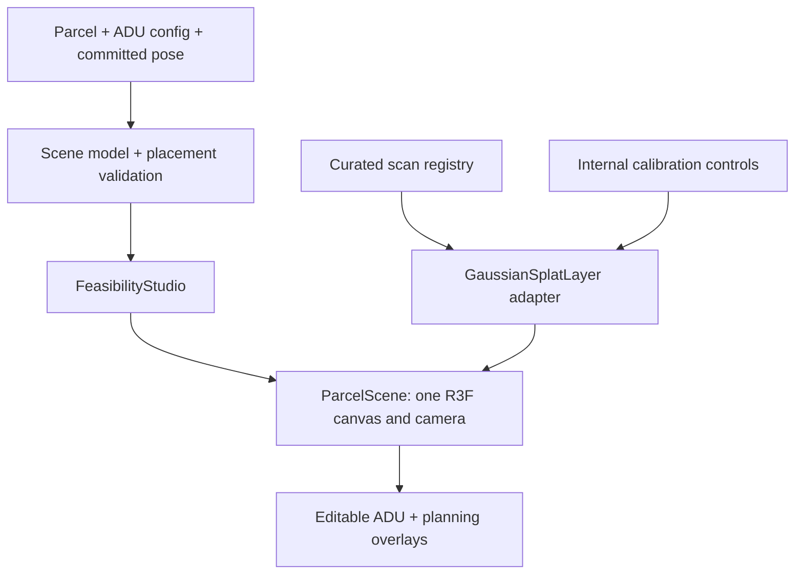

# 3DGS renderer assessment and integration direction

Date: 2026-09-14. Branch: `beta/3dgs-studio`, inspected at `53c9be1`.
Status: source and dependency research; no renderer installed in the app or WebGL spike completed.

## Recommendation

Keep the existing Three.js/R3F Studio as the editable property workbench. Evaluate **Spark** behind `GaussianSplatLayer` as the first implementation spike, including a controlled Three.js upgrade. Use **CesiumJS** when geographic navigation and streamed neighborhood context become required. These are proposed technical choices, pending runtime evidence.

The product concept is a photographed yard with a dimensioned, movable ADU and visible planning overlays. Scan calibration changes the visual background; `scene-model`, `site-fit`, and `placement-validation` continue to supply dimensions and verdicts.

## Setup completed

- Switched the clean YardUp checkout from `master` to the existing remote-tracking `beta/3dgs-studio` branch.
- Added `CesiumGS/cesiumjs-skills` to Claude's user marketplaces and installed `cesiumjs-skills@cesiumjs-skills` at user scope. `claude plugin list` reports version `0.3.0`, enabled. Marketplace checkout: `5f4792c09c4496f214ba9679cac6d7b3b014dcdd`.
- Consulted its orientation, 3D Tiles and spatial-math skills. An already-running Claude session can activate the installation with `/reload-plugins`. This installs agent guidance, not the Cesium runtime into YardUp. [Plugin documentation](https://github.com/CesiumGS/cesiumjs-skills).

## Renderer comparison

| Candidate | Verified fit | Cost or limitation | Proposed role |
| --- | --- | --- | --- |
| GaussianSplats3D `0.4.7` | npm peer range `three >=0.160.0` includes installed `0.164.1`; supports an external scene/drop-in viewer | Maintainer says development is inactive. Documents PLY/SPLAT/KSPLAT, not SPZ. Mobile performance and transparent composition need testing | Compatibility fallback only |
| Spark `2.2.0` | Three.js objects, existing WebGLRenderer/camera, SPZ and other scan formats | npm requires `three >=0.180.0`; current Studio is `0.164.1`. Upgrade Three and its types together and check R3F/Drei/Remotion users | Preferred property-viewer spike |
| CesiumJS | Native streaming of splats through 3D Tiles/glTF; supports combining reconstructed assets with geographic datasets | Own renderer, camera, world coordinates and interaction APIs; existing R3F components cannot simply be mounted into its scene | Geographic context option after property beta |

Versions and peer ranges were queried from npm on this date; they are compatibility constraints, not successful runtime tests. [GaussianSplats3D maintenance and formats](https://github.com/mkkellogg/GaussianSplats3D), [Spark capabilities](https://sparkjs.dev/docs/overview/), [Spark package](https://github.com/sparkjsdev/spark/blob/main/package.json), [Cesium streaming architecture](https://cesium.com/blog/2026/04/27/3d-gaussian-splats-lod/).

## Fit into the current app

`FeasibilityStudio.tsx` already dynamically imports `ParcelScene` with SSR disabled and owns the primary view mode. `ParcelScene.tsx` uses demand rendering and owns placement, camera controls and `AduArchitecture`. The pure `lib/scene-model.ts` uses feet, lot-centered X/Z, Y up, and positive Z toward the frontage.

Implementation boundaries:

1. `lib/splat-scene.ts`: asset identity/version, format, source units and axis convention, visual-calibration provenance, uniform scale, yaw and translation in feet. Normalize source axes/tilt before the yaw-only workbench. Keep geographic registration separate from local scan calibration.
2. `lib/splat-registry.ts`: match an actual scan to its property. A generic sample can validate rendering but must be labeled synthetic/demo context; it cannot establish a real address match. No scan files were found under current `public/`.
3. `GaussianSplatLayer.tsx`: lazy-load the renderer; use R3F's existing `gl`, scene and camera; own loading, failure and disposal. Avoid a second canvas or independent animation loop. Invalidate on scan load, calibration, camera movement and asynchronous sorting completion; prove that the final sorted frame renders when interaction stops.
4. `ParcelScene.tsx`: retain ADU and interaction geometry; suppress duplicate synthetic house/ground/trees only when scan loading succeeds. Restore ordinary 3D on failure. Keep annotations readable through an explicit overlay policy.
5. `FeasibilityStudio.tsx` and its view controls: expose Scan only for registered beta data. Preserve the committed pose/config and existing mobile behavior across mode switches. Calibration belongs to internal tooling and exports a registry transform.

Spark accepts the existing renderer and exposes disposal and asynchronous update behavior. Its default splats depth-test but do not write depth; transparent-object ordering and foliage edges require a real visual test. Do not infer robust occlusion merely because both render in one canvas. Also measure its recommended antialias-off setting against the ADU's mesh edges. [SparkRenderer documentation](https://sparkjs.dev/docs/spark-renderer/).

## Where Cesium fits

Cesium ion can reconstruct uploaded photos into tiled splats and combine them with Google Photorealistic 3D Tiles. Reconstruction remains a tech preview, including potential retiling as it evolves. Google neighborhood imagery does not replace a property-specific capture. [Cesium reconstruction guide](https://cesium.com/learn/reality-data/reconstruction/), [Google 3D Tiles](https://developers.google.com/maps/documentation/tile/3d-tiles).

For a future Cesium context view:

- Load a URL-backed tileset through `Cesium3DTileset.fromUrl`, or an authorized ion asset through `fromIonAssetId`; add it to the Cesium scene. Tileset metadata readiness is distinct from the current view finishing streaming.
- Add Google context only after configuring the required service access and attribution. Its buildings can overlap a newer property scan; test any selective hiding/clipping against that exact content and engine version.
- Introduce a tested lot-to-world transform: convert feet to meters (`0.3048`), apply an explicit axis/bearing rotation into local east/north/up, then use `Transforms.eastNorthUpToFixedFrame` at a known geographic anchor. Record height datum and orientation provenance. An address point alone does not establish lot bearing or ground elevation. [Cesium transforms](https://cesium.com/learn/cesiumjs/ref-doc/Transforms.html#eastNorthUpToFixedFrame).
- Reuse the pure scene model for overlays. A Cesium-native editable ADU would need generated/exported geometry plus new picking/dragging adapters; `AduArchitecture` is a React/Three implementation. Treat that as a separate implementation cost.
- Avoid stacking Cesium and R3F canvases to simulate one scene: they would have independent depth buffers. Start with mutually exclusive views sharing domain state if both engines are needed.

## Next executable slice and acceptance

1. Capture baseline tests/build and existing Studio screenshots. Pin a compatible Spark/Three/types combination in the beta and resolve dependency compatibility without forcing peer installation.
2. Load a small, permissioned real splat in an isolated harness with the current camera, an opaque ADU-sized box and setback lines. Validate SPZ decoding, worker/WASM loading under current headers, visual depth, perspective/orthographic cameras, idle rendering and disposal.
3. Integrate one matching property scan and manual calibration only after the harness works. Check known distances and multiple landmarks; never resize the parcel or ADU to force alignment.
4. Measure first-visible load, compressed/downloaded and decoded memory costs, orbit/drag FPS, and repeated mount/unmount behavior. Existing targets remain <=15 MB, >=45 FPS desktop and >=30 FPS flagship mobile; none are measured yet.
5. Run the existing scene, placement and persistence tests plus mode/calibration regressions, lint, type-check, production build and desktop/mobile browser checks before considering release.

Keep existing COOP/auth/payment headers during the experiment. There is no scan upload, training backend, new storage schema or paid service requirement for this first viewer spike. A curated property scan is still needed for property-level acceptance.
