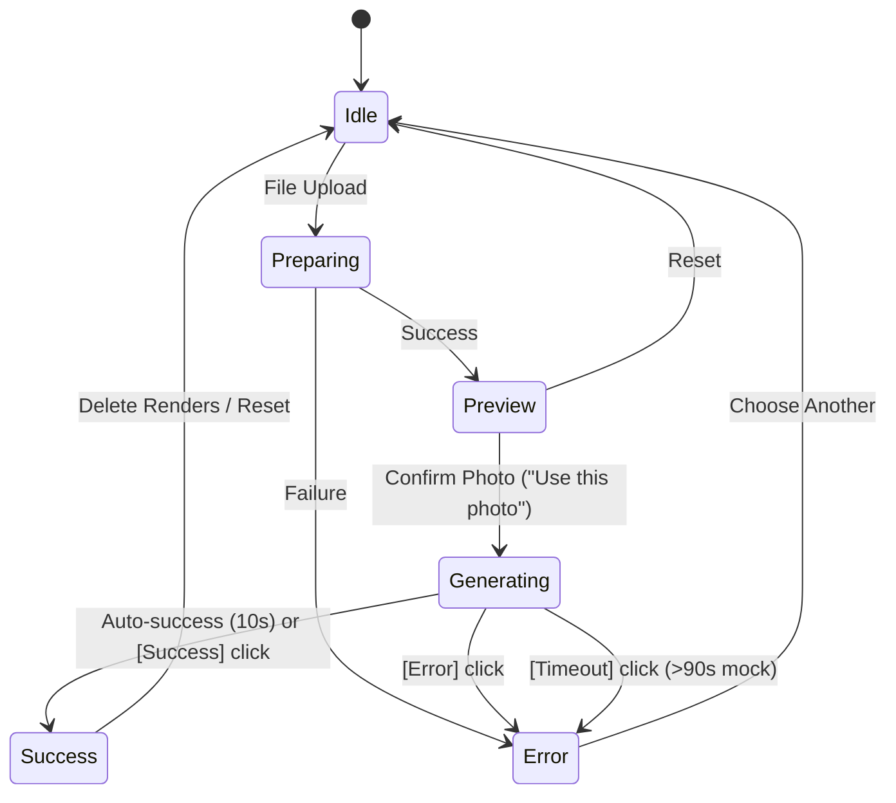

# Design Spec: AI Photo-to-ADU Style Match (T7)

**Summary**: Specification for implementing the AI generation flow in `StyleMatchPanel`, the full-screen Before/After drafting board overlay modal, and inserting the generated style-matched concept into the Inspiration Gallery.
**Sources**: `docs/plans/monetization-marketplace-ai.md`
**Last updated**: 2026-06-20

---

## 1. Goal & Architecture

Provide homeowners with a "magic moment" in the design studio by allowing them to upload a photo of their house and receive an ADU concept customized to match their home's architectural style. 

The feature spans three parts:
1. **Generation Lifecycle**: Simulates casting in the right-rail [StyleMatchPanel](file:///C:/Users/torra/Downloads/Repos/AR%20ADU/urbanlens-landing/components/studio/StyleMatchPanel.tsx) with developer buttons to force success, error, or timeout.
2. **Drafting Board Overlay**: An immersive full-screen overlay dialog [BeforeAfterBoard.tsx](file:///C:/Users/torra/Downloads/Repos/AR%20ADU/urbanlens-landing/components/studio/BeforeAfterBoard.tsx) displaying the side-by-side comparison, metadata summary, and options to attach to the certificate or recast.
3. **Gallery Injection**: Adds a custom card tagged with a `STYLE-MATCHED` mono chip to [InspirationGalleryPanel.tsx](file:///C:/Users/torra/Downloads/Repos/AR%20ADU/urbanlens-landing/components/studio/InspirationGalleryPanel.tsx) that allows loading the styling parameters into the main 3D canvas.

---

## 2. Interaction & State Machine

The [StyleMatchPanel](file:///C:/Users/torra/Downloads/Repos/AR%20ADU/urbanlens-landing/components/studio/StyleMatchPanel.tsx) is updated to support the following status transitions:

### Generating State
- Displays a progress bar and loops through three textual steps:
  1. *Reading materials & roofline* (0–3s)
  2. *Matching siding + trim palette* (3–6s)
  3. *Casting 2BD/1BA DADU concept* (6–10s)
- Pushes small, absolute-positioned developer bypass buttons to the screen:
  - **`[Success]`**: Resolves immediately.
  - **`[Error]`**: Triggers "The cast didn't take" state.
  - **`[Timeout]`**: Displays the timeout error.
- If no bypass is clicked, automatically resolves to **Success** after 10 seconds.
- The rest of the studio controls remain interactive and usable while casting is active.

### Error State
- Triggers a custom error card: `"⚠ The cast didn't take. We couldn't read enough of the house from this photo. Try a daylight shot. Your photo was not stored."`
- Puts two action buttons: `[Try another photo]` (resets status) and `[Retry]` (re-runs generation).

---

## 3. Before/After Drafting Board Overlay

Renders as a `fixed` position overlay with an espresso backdrop (`bg-lf-espresso/90`). 

### UI Details
- **Eyebrow Header**: Pinned with double-ruled line, showing `STYLE CONCEPT · NO. SM-{hash} · RECORDED UTC`.
- **Split Stage**: 
  - Left Pane: `"Before — your photo"` showcasing the uploaded image.
  - Middle Spine: Vertical rule with arrow `→`.
  - Right Pane: `"After — ADU concept, matched style"` showing the generated concept image (a high-quality pre-rendered mockup placeholder) and a stamp: `CONCEPT · NOT A PERMIT` (rotated 5 degrees in brick red).
- **Metadata Badge**: A background-tinted flex bar showing style match percentage (e.g. `STYLE MATCH CRAFTSMAN · 91%`), matched traits (`Cedar lap siding`, `Gable roof`, `White trim`), and properties.
- **Action Buttons**:
  - `Add to certificate`: Toggles the PDF export inclusion state. Shows a checkmark and "Applied" label.
  - `Cast another`: Resets the panel state back to `idle` for a new upload.
  - `Delete photo & renders`: Discards the image and closes the overlay.

---

## 4. Gallery Integration

The new concept is dynamically prepended to the array of inspiration templates in [InspirationGalleryPanel.tsx](file:///C:/Users/torra/Downloads/Repos/AR%20ADU/urbanlens-landing/components/studio/InspirationGalleryPanel.tsx).

- **Card Styling**: Added `STYLE-MATCHED` mono label in the image corner.
- **Applying to Studio**: Clicking `[Apply to Studio]` on this custom card sets the 3D studio canvas presets:
  - Footprint / dimensions matching the template.
  - Roof type (e.g., `gable` / `shed`) matching the concept.
  - Finish style (e.g. `cedar` / `lap` / `stucco` / `board`) matching the concept.

---

## 5. Verification Plan

- **Tests**:
  - Run `npm run test` to verify no regressions in existing components.
  - Add tests in `StyleMatchPanel.test.tsx` verifying:
    * Click "Use this photo" enters `generating` state.
    * Developer mock buttons (`[Success]`, `[Error]`, `[Timeout]`) trigger correct state transitions.
    * Error states and timeout (>90s) displays render correct warning text.
  - Add tests for `BeforeAfterBoard` confirming overlay renders and closing/attachment buttons dispatch correct callbacks.

---

## Related Pages

- [[docs/plans/monetization-marketplace-ai.md]]
- [[components/studio/StyleMatchPanel.tsx]]
- [[components/studio/InspirationGalleryPanel.tsx]]
